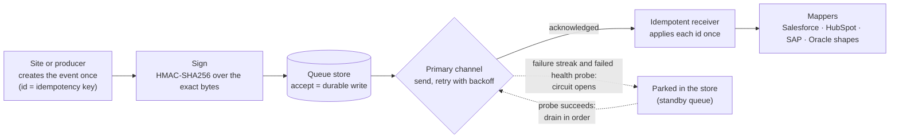

# Enterprise architecture: what is evidenced, and how to check it

This folder backs the claims the site makes in its Architecture section (cards IV, V and VI, and the architectural breakdowns): signed and
verified webhooks, idempotent delivery, bounded retries, redundant queues, and integrations with systems such as Salesforce, SAP, HubSpot and
Oracle. It is written for an engineering reader: a CTO, a security reviewer, a procurement team.

Everything here is a **reference**: concrete interfaces, schemas, code and executable tests. It shows how the pattern is built and that it
behaves as described. It is not a product, not a certification and not a description of a client system. Read "Not claimed" below before
quoting anything from it.

## The flow



The same flow, in words: an event is born with an id that never changes. It is signed over its exact bytes and written to a durable store
before anything is acknowledged. A sender takes it from the store and delivers it at least once; when the channel fails, it is retried with
backoff and, when the channel is clearly down, parked until a health probe passes. The receiver recognises an id it has already applied and
drops the repeat, so at-least-once delivery has an at-most-once effect. A mapper turns the canonical event into the shape of the system that
needs it.

## Evidence tiers

Every claim sits in exactly one tier. A claim is never described as being in a higher tier than it is.

| Tier | What it means | Where to look |
|---|---|---|
| **A. Implemented in this repository** | Runs in the production code of this site and is exercised by the smoke tests. | `lib/server/deliver.ts`, `app/api/briefing/route.ts`, `scripts/smoke.mjs` |
| **B. Reference implementation, verified by tests** | Written as dependency-free TypeScript, runs in Node and in the browser, and is checked by executable contract tests (`npm run arch:verify`). Not wired to a client's systems here. | `lib/arch/`, `tests/arch/`, this folder |
| **C. Not claimed** | Needs a client's environment, credentials, volumes or legal context. Listed below so nobody has to guess. | "Not claimed" |

### What the site says, and where the evidence is

| Claim on the site | Tier | Evidence |
|---|---|---|
| Webhooks are signed | A | The briefing delivery signs its body with HMAC-SHA256 in the `x-syncflow-signature: sha256=<hex>` header (`lib/server/deliver.ts`); `scripts/smoke.mjs` recomputes the signature at a mock receiver. |
| ...and verified before anything trusts them | B | `verifyEnvelope` in `lib/arch/envelope.ts` checks the signature (constant time) over the bytes received, then freshness, then shape, in that order. `tests/arch/envelope.test.ts` includes the RFC 4231 HMAC-SHA256 test vector, one-character tampering, another key, a stale and a future timestamp. |
| Idempotent delivery | A and B | A: every delivery carries `id` in the body and the `idempotency-key` header, the same on every attempt. B: `IdempotentReceiver` in `lib/arch/queue.ts`; the scenarios below show repeats dropped. |
| Bounded retries | A and B | A: at most two attempts inside a 9.5 s budget, retried only after a timeout, a network error or 5xx/408/429, never after another 4xx (`lib/server/deliver.ts`, ADR 0010). B: `maxAttempts`, backoff and dead-letter in `lib/arch/queue.ts`. |
| Redundant queue architectures keep events moving when one path goes quiet | B | `ReliableQueue` in `lib/arch/queue.ts` and the scenarios in `fail-safe-queue.md` (outage, flapping channel, restarts). The site's own briefing path has no standby queue; a client project wires this pattern to a durable store of its choice. |
| HMAC-SHA256, zero-trust verification, AES-256-GCM, idempotency keys | B | `lib/arch/envelope.ts` and its tests; the live model on the site (`components/sim/SecurityFlowSim.tsx`) calls the same functions. |
| Salesforce, SAP, HubSpot and Oracle are part of the architecture | B | `lib/arch/mappers.ts`, `integrations.md`, `canonical-event.schema.json`, `examples/`. Illustrative shapes, see the disclaimer in `integrations.md`. |

## Verify it yourself

```
npm run arch:verify              # the contract tests (about a second, nothing to install)
npm run arch:verify -- --report  # also print what every queue scenario does
npm run arch:examples            # rewrite examples/ and the generated tables from the code
```

The tests fail when the documents and the code disagree: the example files, the scenario table in `fail-safe-queue.md` and the mapping
tables in `integrations.md` are generated from `lib/arch/` and compared byte for byte; the JSON Schema is checked against the validator
(everything the schema refuses, the validator refuses, and the other way round for the reference events); every file this folder points at
has to exist. The validator is the stricter of the two: it also refuses text that is only whitespace.

## Files

| File | What it holds |
|---|---|
| `canonical-event.schema.json` | The envelope every system receives, as JSON Schema 2020-12 (same contract as `lib/arch/types.ts` and `lib/arch/event.ts`). |
| `fail-safe-queue.md` | The queue: its properties and what each one costs, the state machine, the scenarios and their results. |
| `security-envelope.md` | Signing, zero-trust verification and sealing: the steps, their order, and what each one refuses. |
| `integrations.md` | The field mapping to each system, with example output. |
| `examples/` | Reference events, the mapped payloads, a signed envelope and the scenario results, all generated. |

## Not claimed

These are never implied by this folder, by the site or by the interactive models:

- **Live connectors.** No connector to Salesforce, SAP, HubSpot or Oracle is shipped or running here, and no credentials, sandbox or
  tenant of any of them was used. The payload shapes are illustrative (see `integrations.md`).
- **Partnership, certification, listing or conformance.** Product names belong to their owners. Nothing here is approved by, affiliated with
  or tested for certification by any vendor, and no conformance to any vendor API is claimed.
- **Production figures.** No uptime, availability, throughput, latency, delivery rate or SLA is stated for any deployment. The scenario tables
  describe a deterministic model, not a measurement of a running system.
- **Compliance statements.** No claim of compliance with a standard or a regulation (ISO, SOC, GDPR or any other) is made. The pattern
  supports a client's own compliance work; it does not replace it.
- **Production readiness of the reference as it stands.** `MemoryStore` is an in-memory store for tests; a deployment backs the queue with a
  durable database or managed queue, runs the receiver where the business system is, and is tested under that client's own failure
  and load conditions. Key generation, storage, rotation and access are the client's and are out of scope here.
- **That a pattern removes risk.** It narrows specific, named failure modes (a lost event, a repeated event, an unsigned or replayed request).
  Other failure modes remain and are handled per project.
