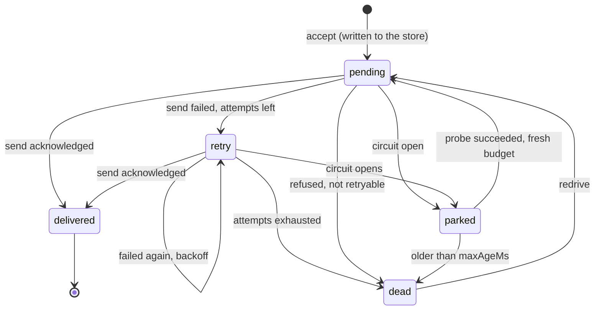

# The fail-safe queue

Reference implementation: `lib/arch/queue.ts` (types in `lib/arch/types.ts`). Verified by `tests/arch/queue.test.ts` against the deterministic
scenarios in `lib/arch/scenarios.ts`. The interactive model on the site (Architecture, card IV) shows the same pattern; it is a drawing of the
idea, while this document and the tests are about the code.

The queue is a small state machine with **no timers and no I/O of its own**. The caller says what time it is (`pump(now)`) and supplies the
durable store and the channel. That is why the same code runs in a deterministic simulation, in the browser and, with a real store and a real
channel, in a project.

## What it provides, and what each property costs

| Property | How | Cost |
|---|---|---|
| **Durability** | `accept` writes the event to the store before it answers. An accepted event survives a restart: rebuild the queue from `store.snapshot()`. | The store is a dependency: its own durability is the client's choice (database, managed queue). |
| **At least once** | A failed or unacknowledged send is sent again with the same event id. | Repeats happen, so the receiver must cope with them. |
| **Effectively once** | `IdempotentReceiver` applies an id once and drops the repeat. | The receiver must remember ids for longer than the longest time the queue can keep retrying (`ttlMs`). |
| **Order** | With `strictOrder` an event waits for every lower sequence number to be delivered or dead. | Head-of-line blocking: one failing event delays the ones behind it, until it succeeds or is dead-lettered. Switch it off for independent events. |
| **Bounded** | An event is sent at most `maxAttempts` times (default 6, backoff 0.2, 0.4, 0.8, 1.6, 3.2 s) while the channel is healthy, then dead-lettered: kept, never dropped. A non-retryable refusal is dead-lettered at once. An event older than `maxAgeMs` (default a day) expires into the dead letters. | Dead letters need an owner: someone has to look at them and `redrive` them. |
| **Outage handling** | After `openAfter` failures in a row (default 3) **and** a failed health probe, the circuit opens: nothing is sent, accepted events are parked in the store, and only a probe every `probeMs` (default 1 s) tests the channel. Probes cost no attempts, so an outage never kills an event. When a probe succeeds the circuit closes and the parked events drain in order with a fresh budget. | While the circuit is open, delivery waits. That is the point; how long is acceptable is a business decision (`maxAgeMs`). |
| **Poison isolation** | A failing event on a healthy channel (the probe passes) is a bad event, not a dead channel: it is retried with backoff, then dead-lettered, and the circuit stays closed. | Needs a meaningful `probe`: it must test the channel, not the event. |

## State machine

## Scenarios and results

Each scenario is deterministic (a virtual clock, a seeded random generator, no timers, no network). `npm run arch:verify` asserts, on every
one of them, that **no accepted event is lost, no event is applied twice, the order of acceptance is kept, and no event is sent more often
than the policy allows**. The table is generated from the code and compared with this file by the tests; `npm run arch:verify -- --report`
prints it.

<!-- scenarios:start -->
| Scenario | Accepted | Applied once | Repeats dropped (receiver / queue) | Dead-lettered | Lost | Order | Circuit |
|---|---:|---:|---:|---:|---:|:--|:--|
| healthy channel | 50 | 50 | 0 / 0 | 0 | 0 | kept | never opened |
| channel down for 20 s, then restored | 40 | 40 | 0 / 0 | 0 | 0 | kept | opened and closed |
| flapping channel (down three times for 3 s) | 40 | 40 | 0 / 0 | 0 | 0 | kept | opened and closed |
| acknowledgements lost on 30 % of sends | 60 | 60 | 28 / 0 | 0 | 0 | kept | never opened |
| one poison event among 20 (refused, not retryable) | 20 | 19 | 0 / 0 | 1 | 0 | kept | never opened |
| one stubborn event among 20 (503 for it alone, retryable) | 20 | 19 | 0 / 0 | 1 | 0 | kept | never opened |
| process restarts twice during an outage | 30 | 30 | 0 / 0 | 0 | 0 | kept | opened and closed |
| the producer sends every 5th event twice | 30 | 30 | 0 / 6 | 0 | 0 | kept | never opened |
| everything at once | 80 | 77 | 14 / 8 | 3 | 0 | kept | opened and closed |
<!-- scenarios:end -->

How to read it: *Accepted* is the number of distinct events the queue took in. *Applied once* is the number of events the receiver applied.
*Repeats dropped* counts the copies the receiver (a lost acknowledgement made the queue send again) and the queue (a producer that sent an
event twice) recognised and refused. *Dead-lettered* events are kept for a person to look at. *Lost* is accepted minus (applied + dead-lettered
+ still waiting): it is zero in every row, which is the claim.

## Wiring it to a real system

1. Implement `QueueStore` (five operations) on a durable store. Keep `put` atomic with the acceptance you acknowledge to the producer.
2. Implement `Transport.send` to call the business system (or its integration layer) and `probe` to test the channel, not an event.
3. Run `pump(Date.now())` from a scheduler (a worker, a cron, a queue consumer). It does one pass and returns what happened.
4. Run `IdempotentReceiver` (or its equivalent) where the business system is, and make `ttlMs` longer than `maxAgeMs`.
5. Give dead letters an owner and an alert. Decide `strictOrder` per event type.
6. Test it under that system's failure and load conditions. The scenarios above prove the logic; they say nothing about a client's volumes.
